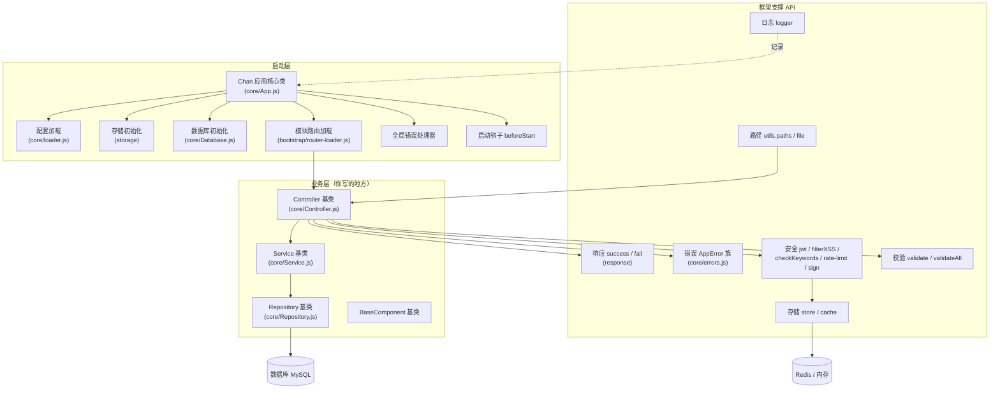

# Chanjs 框架开发教程（对外 API 全解）

> 目标读者：刚接触 Node.js / Express 的小白，以及需要在 ChanCMS 上做二次开发的工程师。
> 本文档只讲**框架对外提供的函数与类**，所有签名均来自 `chanjs` 源码（`node_modules/chanjs`），可放心照抄。
> 配套示例尽量贴近真实业务（`chancms-vip` 项目）。

---

## 一、Chanjs 是什么

Chanjs 是一个基于 **Node.js + Express 5** 的 **标准 HMVC 框架**（可称 NHMVC，New-generation HMVC）。

它的内核不是"轻量 CMS"，而是**模块化 + 模块自治 + 跨模块复用**：

- **模块自治**：每个业务模块（`app/modules/<module>/`）是独立的 MVC 单元，自带 `controller/`、`service/`、`middleware/`、`router.js`
- **跨模块双通道协作**：`this.get("模块","Controller")` 取其它模块的 Controller、`this.get("模块","Service","service")` 取其它模块的 Service，按需加载、永久缓存、低耦合
- **分层职责**：Controller（接口）→ Service（业务逻辑）→ Repository（数据库 CRUD）

技术底座：

- **Node.js** + **Express 5**（HTTP 服务与路由）
- **Knex**（数据库查询构造器，支持 MySQL / PostgreSQL / SQLite）
- **art-template**（模板引擎，用于前台页面渲染）

它帮你把"建表、写接口、做鉴权、渲染页面"这些重复劳动封装好，你只需写**业务层**：Controller（接口）、Service（业务逻辑）、Repository（数据库 CRUD）。

---

## 二、整体架构与代码关系图



**一句话理解调用链：**
`HTTP 请求` → `路由 (router.js)` → `Controller.方法()` → `Service.方法()` → `Repository.方法()` → `数据库`。
过程中用 `this.success()` 返回数据，用 `AppError` 抛错，用 `store/cache` 做缓存，用 `logger` 打日志。

### HMVC 架构定位

教科书 HMVC 的"标准"是 **Controller 嵌套调用 Controller + 运行时子请求**，这其实是把**实现手段**当成了标准，是片面的。
HMVC 的本质是**分层 + 模块自治 + 跨模块复用**。Chanjs 抓住本质，实现**标准 HMVC**：

- 每个业务模块是自治的 MVC 单元（`controller/` + `service/` + `middleware/` + `router.js`）
- 支持**双通道跨模块协作**：`this.get("模块","Controller")` 拿 Controller、`this.get("模块","Service","service")` 拿 Service
- 模块间按需加载、永久缓存、低耦合

| 维度 | 教科书 HMVC（过时） | Chanjs（标准 HMVC） |
|---|---|---|
| HMVC 定义依据 | 把"Controller 嵌套 + 子请求"当标准 | 以"模块自治 + 跨模块复用"本质为标准 |
| 跨模块协作 | Controller 嵌套调用 Controller | **双通道**：`get(Controller)` 或 `get(Service)` |
| 典型调用链 | Controller → 嵌套 Controller → 子 View | Controller → 跨模块 `get()` → 复用模块能力 |
| 复杂度 | 高（子请求开销、栈深、职责混乱） | 低（一层 get、层级简单） |

结论：教科书把实现手段当标准，是过时的变体；Chanjs 还原 HMVC 本质，才是更贴近定义的**标准实现**。

---

## 三、怎么拿到这些 API

业务代码里统一这样引入（全部从根包 `"chanjs"` 导出）：

```js
import Controller, { Service, Repository } from "chanjs";
import { success, fail } from "chanjs";          // 也可从 Controller 里用 this.success
import { AppError, ValidationError } from "chanjs";
import { setToken, getToken, verifyToken, revokeToken } from "chanjs";
import { filterXSS, checkKeywords, createRateLimitMiddleware } from "chanjs";
import { store, cache } from "chanjs";
import logger, { createLogger } from "chanjs";
import { validate, validateAll } from "chanjs";
import { utils, Paths } from "chanjs";            // utils 工具集 / Paths 路径常量
import Chan from "chanjs";                        // 应用核心类（入口 app.js 用）
```

> ⚠️ **重要**：`chanjs/index.js` 的导出列表是唯一权威来源。若你 `import` 了某个名字却报
> `does not provide an export named 'xxx'`，先去 `chanjs/index.js` 看是否真的导出了——**新增 import 前务必核对导出列表**。

---

## 四、最小可运行示例（先有个整体印象）

`app.js`（项目入口）：

```js
import Chan from "chanjs";

const app = new Chan();

// 启动前钩子：可做一次性初始化
app.beforeStart(async () => {
  console.log("准备启动...");
});

app.start().then(() => {
  app.run(port => console.log("监听", port));
});
```

`modules/demo/router.js`：

```js
import { loader } from "chanjs";

// 框架自动扫描 app/modules/*/router.js 并调用本函数完成路由注册
export default async (app, router, config) => {
  const controller = await loader.loadController("demo");
  router.get("/demo/list", controller.Demo.list);
};
```

`modules/demo/controller/DemoController.js`：

```js
import { Controller, Service, Repository } from "chanjs";

class DemoRepo extends Repository {
  constructor() { super("demo_table"); }   // 表名
}

class DemoService extends Service {
  constructor() { super(); this.repo = new DemoRepo(); }
  async list() { return this.repo.all(); }
}

export class DemoController extends Controller {
  constructor() { super(); this.service = new DemoService(); }
  async list(req, res) {
    const data = await this.service.list();
    this.success(data);   // → { success:true, code:0, msg:"操作成功", data }
  }
}
```

---

## 五、文档导航（按学习顺序）

| 文件 | 讲什么 | 适合谁 |
|---|---|---|
| [01-核心类.md](./01-核心类Controller-Service-Repository.md) | `Controller` / `Service` / `Repository` / `BaseComponent` 三个基类怎么用 | 所有人，最先看 |
| [02-响应与错误.md](./02-响应与错误.md) | `success` / `fail` / `AppError` 族 / `CODE` 错误码 | 写接口必看 |
| [03-安全模块.md](./03-安全模块.md) | JWT 登录态、XSS 过滤、关键词校验、限流、加解密 | 做登录/评论/表单必看 |
| [04-存储与缓存.md](./04-存储与缓存.md) | `store`（Redis/内存）、`cache`（内存缓存） | 做缓存/限流/黑名单必看 |
| [05-工具与校验.md](./05-工具与校验.md) | `logger`、`Paths`、`safePath`、`validate` / `validateAll` | 日常工具 |
| [06-应用生命周期.md](./06-应用生命周期.md) | `Chan` 类、`beforeStart`、`loader`、`registry` | 想理解启动流程/写启动钩子 |
| [07-事件系统EventBus.md](./07-事件系统EventBus.md) | `EventBus` / `event` 事件总线 | 做模块解耦 / 异步通知 |
| [08-定时任务Task.md](./08-定时任务Task.md) | `Task` 定时任务（cron） | 做定时清理 / 同步 / 报表 |
| [09-国际化Lang.md](./09-国际化Lang.md) | `initLang` / i18next 多语言 | 做多语言站点 |

---

## 六、约定与名词

- **业务码 `code`**：`0` 成功；`1xxx` 业务错误（1001 未登录、1003 无权限…）；`5xxx` 系统；`6xxx` 数据库。
- **响应信封**：所有 JSON 接口统一返回 `{ success, code, msg, data }`。
- **`this.app`**：业务对象上能拿到 `app`（Chan 实例）、`app.db`（默认数据库连接）、`app.config`、`app.dbManager`。
- **`req.validated`**：经过 `validate` / `validateAll` 中间件后，校验通过的参数会挂在这里。
- **多数据库**：Repository 构造传第二个参数 `dbName` 即可切换连接（`app.dbManager.get(dbName)`）。
