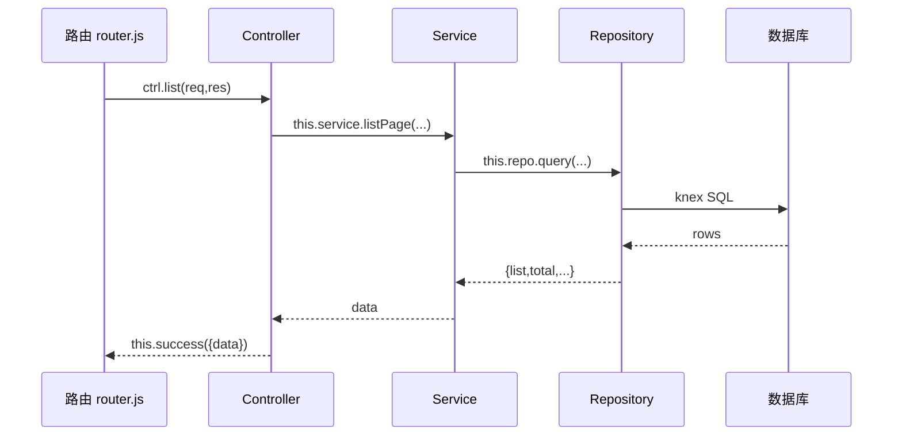

# 01 · 核心类：Controller / Service / Repository / BaseComponent / Container

Chanjs 推荐**三层结构**：Controller 收请求、Service 写业务逻辑、Repository 管数据库。
三者都通过继承基类自动获得 `this.app`、`this.config`、`this.db` 等运行时能力。

---

## 0. 类继承关系（务必看清）

| 类 | 直接父类 | 拥有的能力 |
|---|---|---|
| `BaseComponent` | — | `this.app` / `this.config` / `this.db` |
| `Container` | `BaseComponent` | 上面三个 **+ `this.get()` 跨模块按需加载** |
| `Controller` | `Container` | 上面全部 **+ `this.success()` / `this.fail()`** |
| `Service` | `Container` | 上面全部（`this.get()` 可用） |
| `Repository` | `BaseComponent` | **只有** `this.app`/`this.config`/`this.db`，**没有 `this.get()`** |

> ⚠️ **重要**：`Repository` 直接继承 `BaseComponent`，**不继承 `Container`**，因此 Repository 里**不能** `this.get()`。
> 跨模块取组件（`this.get()`）只在 **Controller / Service** 上可用。Repository 需要别的模块数据时，
> 由上层 Service 取好后传入，或 Repository 直接用 `this.db("其它表")` 跨表查。

---

## 1. BaseComponent（最底层基类）

所有业务组件的"祖父类"。它把 `app / config / db` 这些运行时对象挂到 `this` 上。

```js
class BaseComponent {
  get app()      { return getApp(); }   // 全局 Chan 实例
  get config()   { return this.app?.config ?? {}; }
  get db()       { return this.app?.db ?? null; }  // 默认数据库连接（knex 实例）
}
```

**你能直接用到的：**
- `this.app` —— 整个应用实例（含 `dbManager`、`config`、`paths`、`event`、`task`、`lang`）。
- `this.db` —— 默认数据库连接（knex 查询构造器入口），例如 `this.db("user").where({id})`。
- `this.config` —— 配置对象（来自 `.env` 与 `config/`），未初始化时返回 `{}` 避免 `undefined.xxx` 报错。

> 实际开发中你几乎不直接继承 `BaseComponent`，而是继承它更具体的子类 `Service` / `Repository` / `Controller`。
> **注意**：早期文档提到 `BaseComponent` 有 `on()` 生命周期钩子，这是**错误**的，源码里 `BaseComponent` 没有 `on()`。

---

## 2. Repository（数据访问层）

文件：`core/Repository.js`。封装了通用 CRUD，**你一般只需 `extends Repository` 并传入表名**。
注意：**Repository 没有 `this.get()`**，只能访问 `this.db`（默认库）或通过构造第二参切换库。

### 2.1 构造

```js
class UserRepo extends Repository {
  constructor() {
    // super(表名, 可选db名, 可选{dateFields})
    super("cms_user", null, { dateFields: ["created_at", "updated_at"] });
  }
}
```

| 参数 | 类型 | 必填 | 说明 |
|---|---|---|---|
| `table` | string | ✅ | 数据库表名 |
| `dbName` | string \| null | ❌ | 指定数据库连接 key；不传用默认库（`app.db`）。传了则每次取 `app.dbManager.get(dbName)` |
| `opts.dateFields` | string[] | ❌ | 这些字段在写入时若传字符串会被自动转成 `Date` 对象 |

> 实例属性 `this.limit`：返回 `config.LIMIT_MAX || 300`，是分页每页上限。

### 2.2 查询类方法

所有方法返回统一信封 `{ success, code, msg, data }`（失败信封见 02 文档）。

| 方法 | 签名 | 返回 `data` | 说明 |
|---|---|---|---|
| `all` | `all({ query={}, sort={}, fields=[], limit=1000 })` | `Array` | 查全部，默认上限 1000；`limit<=0` 表示不限 |
| `find` | `find({ query={}, sort={}, fields=[], limit, offset })` | `Array` | 偏移分页查询（`limit`/`offset` 为数字时生效）|
| `findOne` | `findOne({ query={}, fields=[] })` | 行对象 | 查单条；无则 `code=1004` 且 `data=null` |
| `findById` | `findById(id, { fields=[] })` | 行对象 | 等价于 `findOne({ query:{id}, fields })` |
| `query` | `query({ current=1, pageSize=10, query={}, sort={}, field=[] })` | 分页对象（见下）| **标准分页查询** |
| `count` | `count(query={})` | `{ count:number }` | 统计符合条件行数 |
| `exists` | `exists(query={})` | `{ exists:boolean }` | 是否存在 |
| `join` | `join({ joinTable, localField, foreignField, fields=[], query={}, sort={} })` | `Array` | 联表查询（表名/字段有白名单校验）|
| `stats` | `stats()` | `{ total, today }` | 表总记录数 + 今日（`created_at/createdAt` 字段）新增数 |

**分页 `query()` 的返回结构（前端最爱）：**
```json
{
  "success": true, "code": 0, "msg": "查询成功",
  "data": {
    "list": [ /* 当前页数据 */ ],
    "total": 135,
    "current": 1,
    "pageSize": 10,
    "totalPages": 14
  }
}
```

**`query` / `sort` / `fields` 怎么写：**
```js
await repo.query({
  current: 1,
  pageSize: 10,
  query: { status: 1, cid: 5 },                 // 等值条件
  // query 还支持操作符：
  //   { pv: { $gt: 100 } }           大于
  //   { title: { $like: "%foo%" } }  模糊
  //   { id: { $in: [1,2,3] } }        in
  //   { deleted_at: { $null: true } } 为空（true→IS NULL，false→IS NOT NULL）
  //   { deleted_at: { $notNull: true } } 不为空
  sort: { created_at: "desc" },                // 排序，字段有白名单校验（asc/desc）
  field: ["id", "title", "created_at"],        // 只取这些列（"*" 也行）
});
```

> ⚠️ **安全机制**：所有 `query` / `sort` / `field` 的字段名都必须匹配正则 `/^[a-zA-Z_][a-zA-Z0-9_]*$/`，
> 非法字段会被**静默忽略**（并在日志 warn）。这是防 SQL 注入的第一道关。

### 2.3 写入类方法

| 方法 | 签名 | 返回 `data` | 说明 |
|---|---|---|---|
| `insert` | `insert(data={})` | `{ insertId, affectedRows:1 }` | 单条插入；`data` 为空返回 `code=1007` |
| `insertMany` | `insertMany(records=[])` | `{ insertId, affectedRows:N }` | 批量插入 |
| `update` | `update({ query, data })` | `{ affectedRows }` | 条件更新；缺 `query`/`data` 返回 `code=1006` |
| `updateById` | `updateById(id, data={})` | **更新后的完整行** | 按主键更新并返回新行 |
| `updateMany` | `updateMany([{query,data}])` | `{ affectedRows }` | **事务**批量更新，失败自动回滚 |
| `del` | `del(query={})` | `{ affectedRows }` | 条件删除；`query` 为空返回 `code=1007` |
| `delById` | `delById(id)` | `{ affectedRows }` | 按主键删（即 `del({ id })`）|
| `delMany` | `delMany(ids=[])` | `{ affectedRows }` | 按 ID 数组批量删（`whereIn('id', ids)`）|

**写操作示例：**
```js
const r1 = await repo.insert({ name: "张三", age: 18 });
console.log(r1.data.insertId);

const r2 = await repo.updateById(1, { name: "李四" });
console.log(r2.data.name); // "李四"

await repo.del({ id: 1 });  // 或 repo.delById(1)
```

> 🛡️ **fail-closed 保护**：`del` 和 `update` 在「查询条件字段全部非法 / 为空」时会**拒绝执行**
> （返回 `code=参数无效`），避免生成不带 WHERE 的「全表删除/更新」灾难。所以删除一定要带有效条件，例如 `del({ id })`。

### 2.4 完整示例（Repository）

```js
import { Repository } from "chanjs";

export class ArticleRepo extends Repository {
  constructor() {
    super("cms_article", null, { dateFields: ["created_at", "updated_at"] });
  }

  async getHot(limit = 10) {
    return this.db("cms_article")
      .where({ status: 1 })
      .orderBy("pv", "desc")
      .limit(limit);
  }
}
```

---

## 3. Service（业务逻辑层）

文件：`core/Service.js`。它**继承 `Container`（不是 `BaseComponent`）**，本身没有强制方法，
作用是为你定义一个"持有 Repository、聚合多个 Repository、写业务规则"的标准位置。
因为继承 Container，Service 里 **可以 `this.get()` 跨模块取组件**。

```js
import { Service, Repository } from "chanjs";

class ArticleRepo extends Repository {
  constructor() { super("cms_article"); }
}

export class ArticleService extends Service {
  constructor() {
    super();
    this.repo = new ArticleRepo();
  }

  // 业务方法：组合 Repository + 规则
  async listPage(page = 1, pageSize = 10) {
    const res = await this.repo.query({ current: page, pageSize, query: { status: 1 } });
    // 这里可以加缓存、加格式化、调别的 repo……
    return res;
  }

  async createArticle(data) {
    if (!data.title) throw new ValidationError("标题不能为空");
    return this.repo.insert(data);
  }

  // 跨模块取别的模块的 Service（type 默认就是 "service"，可省略）
  async relatedCategory(id) {
    const categorySvc = await this.get("cms", "Category", "service");
    return categorySvc?.findById(id);
  }
}
```

**约定：**
- Service 里 `new` 出它需要的 Repository，挂到 `this.repo` / `this.xxxRepo`。
- 复杂业务（如"发文章同时更新栏目计数"）在 Service 里编排多个 Repository 调用。
- Service 不直接碰 `req/res`，只处理数据和规则，便于单元测试。

---

## 4. Controller（接口层）

文件：`core/Controller.js`。继承 `Container`，**最关键的是内置了 `this.success()` / `this.fail()`**，
且**可以 `this.get()` 跨模块取组件**。

### 4.1 构造与签名

```js
import { Controller, Service } from "chanjs";

export class ArticleController extends Controller {
  constructor() {
    super();                       // 必调
    this.service = new ArticleService();
  }

  // 每个接口方法：(req, res) => Promise<void>
  async list(req, res) { /* ... */ }
}
```

### 4.2 `this.success(opts)` —— 成功返回

```js
this.success({ data: {...}, msg: "操作成功" });
// 实际输出：
// { success: true, code: 0, msg: "操作成功", data: {...} }
```

| 参数 | 类型 | 必填 | 说明 |
|---|---|---|---|
| `opts.data` | any | ❌ | 业务数据，默认 `{}` |
| `opts.msg` | string | ❌ | 提示文案，默认 `"操作成功"` |

> 不需要手写 `res.json(...)`，框架会自动处理。你也可以直接 `return this.success(...)`。

### 4.3 `this.fail(opts)` —— 失败返回

```js
// 方式一：只给字符串，当提示文案（默认 code=1008）
this.fail("用户名已存在");

// 方式二：对象，可指定 code / msg
this.fail({ code: 1008, msg: "验证码错误" });
```

| 参数 | 类型 | 说明 |
|---|---|---|
| `opts` | string | 当成 `msg`；code 默认 1008 |
| `opts.msg` | string | 提示文案 |
| `opts.code` | number | 业务码，如 1008 业务失败 / 1006 参数错误 |

### 4.4 标准 Controller 写法

```js
import { Controller } from "chanjs";
import { ArticleService } from "../service/ArticleService.js";
import { ValidationError } from "chanjs";

export class ArticleController extends Controller {
  constructor() {
    super();
    this.service = new ArticleService();
  }

  async list(req, res) {
    const { current = 1, pageSize = 10 } = req.query;
    const data = await this.service.listPage(Number(current), Number(pageSize));
    this.success({ data });
  }

  async create(req, res) {
    const { title } = req.body;
    if (!title) throw new ValidationError("标题不能为空");  // 抛错会被全局错误处理器接住
    const result = await this.service.createArticle(req.body);
    this.success({ data: result.data, msg: "发布成功" });
  }
}
```

### 4.5 路由里怎么挂

```js
import express from "express";
import { ArticleController } from "./controller/ArticleController.js";

const router = express.Router();
const ctrl = new ArticleController();

router.get("/article/list", ctrl.list.bind(ctrl));
router.post("/article/create", ctrl.create.bind(ctrl));

export default router;
```

> ⚠️ 一定要 `.bind(ctrl)`，否则方法里 `this` 会丢失（拿不到 `this.service` / `this.success`）。

---

## 5. 三层协作流程图



---

## 6. 常见坑

1. **忘记 `super()`**：Controller / Service / Repository 构造里第一句必须 `super()`，否则拿不到 `this.app`。
2. **`this.success` 不是静态方法**：必须在 `extends Controller` 的实例方法里用 `this.success(...)`。
3. **Repository 表名写错**：`super("cms_article")` 的表名必须和数据库一致（注意复数/前缀）。
4. **删除不带条件**：`del({})` 会被框架拒绝（防全表删），务必 `del({ id })`。
5. **路由没 bind**：`router.get("/x", ctrl.list)` 少了 `.bind(ctrl)` 会运行时报 `this is undefined`。
6. **多库切换**：非默认库要在 Repository 构造传 `dbName`，且确保 `config` 里配了该连接。
7. **`Repository` 没有 `this.get()`**：跨模块数据协作请放在 Service 层，`Repository` 只能直接用 `this.db`。

---

## 7. 跨模块调用（容器 `this.get()` / HMVC）

Chanjs 采用**标准 HMVC 架构**：每个业务模块自治，且 **Controller / Service 都继承 `Container`**，
自带 `this.get()` 能力，**无需手写相对路径 import，即可按需获取任意模块的组件**。
（Repository 不继承 Container，所以没有这个方法。）

### 7.1 get 签名

```js
await this.get(moduleName, fileName, type?)
```

| 参数 | 类型 | 必填 | 默认 | 说明 |
|---|---|---|---|---|
| `moduleName` | string | ✅ | — | 目标模块名，对应 `app/modules/<moduleName>/` |
| `fileName` | string | ✅ | — | 组件文件名（不含 `.js`）|
| `type` | `"controller"\|"service"` | ❌ | 本容器类型 | 组件类型 |

- 成功加载（存在）→ 返回实例，并**永久缓存**（进程内不失效）。
- 缺失 → 返回 `null`，不缓存，文件新增后下次立即感知。
- Controller 容器默认 `type="controller"`，Service 容器默认 `type="service"`。

### 7.2 同模块获取（Service 里）

```js
// app/modules/book/service/Book.js
export class BookService extends Service {
  async getCategory(id) {
    // 同模块，无需传 type（本容器就是 service）
    const category = await this.get("book", "BookCategory");
    return category?.findById(id);
  }
}
```

### 7.3 跨模块获取（Controller 里取其他模块的 Service）

由于 Controller 容器默认 `type="controller"`，跨模块取 **Service** 时必须显式传第三参：

```js
// app/modules/web/controller/Book.js
export class BookController extends Controller {
  async detail(req, res) {
    // 跨模块拿 book 模块的 Service（注意第三参 "service"）
    const book = await this.get("book", "Book", "service");
    const special = await this.get("cms", "Special", "service");
    // ...
  }
}
```

> ⚠️ `get` 是异步的，必须 `await`。若同一方法多次使用，可先取到局部变量复用。

### 7.4 与直接 import 对比

| 方式 | 写法 | 特点 |
|---|---|---|
| 直接 import | `import svc from "../../book/service/Book.js"` | 同步、路径长、模块深了易错、无安全校验 |
| `this.get()` | `await this.get("book","Book","service")` | 按模块名寻址、有路径越界/非法名校验、永久缓存 |

**推荐**：Controller / Service 内部的跨模块协作优先用 `this.get()`，避免一堆 `../../` 相对路径；
仅全局中间件（非继承 Container 的场景）仍用 import。

### 7.5 HMVC 定位

教科书把 **Controller 嵌套调用 Controller + 运行时子请求**当作 HMVC 的"标准"，这是把**实现手段**当成了标准，是片面的。
HMVC 的本质是**分层 + 模块自治 + 跨模块复用**。Chanjs 抓住本质，是**标准 HMVC 实现**，并支持**双通道跨模块协作**：

```js
// 通道一：获取其他模块的 Controller（传统 HMVC 能力，默认本容器类型）
const bookCtrl = await this.get("book", "Book");                 // type 默认 controller
// 通道二：获取其他模块的 Service（推荐，业务逻辑复用）
const bookSvc = await this.get("book", "Book", "service");
```

**与教科书 HMVC 的本质对比：**

| 维度 | 教科书 HMVC（过时） | Chanjs（标准 HMVC） |
|---|---|---|
| HMVC 定义依据 | 把"Controller 嵌套 + 子请求"当标准 | 以"模块自治 + 跨模块复用"本质为标准 |
| 跨模块协作 | 仅 Controller 嵌套 | **双通道**：`get(Controller)` 或 `get(Service)` |
| 典型调用链 | Controller → 嵌套 Controller → 子 View | Controller → 跨模块 `get()` → 复用模块能力 |
| 复杂度 | 高（子请求开销、栈深、职责混乱） | 低（一层 get、层级简单） |

**结论**：教科书把实现手段当标准，是过时的变体；Chanjs 还原 HMVC 本质（模块自治 + 跨模块双通道协作），
才是更贴近定义的**标准 HMVC 实现**。
