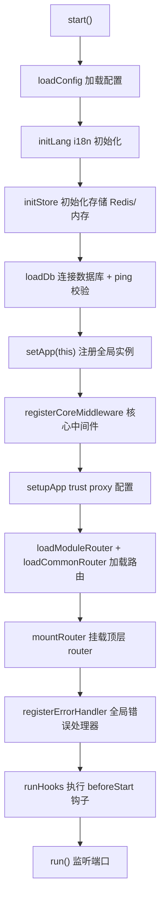

# 06 · 应用生命周期与启动：Chan 类 / beforeStart / loader / registry / dbManager

想理解"程序从启动到监听端口"全过程，或要写启动钩子、访问全局实例，看这篇。

---

## 一、`Chan` 应用核心类

文件：`core/App.js`。整个应用的入口对象。你的 `app.js` 大致长这样：

```js
import Chan from "chanjs";          // 默认导出是 Chan 类

const app = new Chan();

app.beforeStart(async () => {        // 启动前钩子
  console.log("准备就绪");
});

app.start()   // 异步：自动加载 配置/DB/路由/中间件/错误处理器
  .then(() => app.run(port => console.log("监听", port)))
  .catch(err => { console.error(err); process.exit(1); });
```

### 1.1 构造与实例属性

```js
const app = new Chan();
app.app;        // express 实例
app.router;     // 顶层 express.Router()
app.dbManager;  // 数据库管理器（多连接，见 1.4）
app.db;         // 默认数据库连接（knex 实例），#loadDb 成功后赋值
app.config;     // 配置对象（#loadConfig 后）
app.paths;      // Paths 实例
app.hooks;      // 启动钩子数组
app.server;     // http.Server 实例（run 后）
app.event;      // 事件总线单例（EventBus，详见 07）
app.task;       // 定时任务管理器（Task，详见 08）
app.lang;       // i18n 实例（i18next，详见 09）
```

### 1.2 关键方法

| 方法 | 签名 | 说明 |
|---|---|---|
| `start()` | `async start()` | 完整启动流程（见 1.3）|
| `run(cb?)` | `run((port)=>void)` | 启动 HTTP 监听，默认端口 `config.PORT \|\| 3000`；监听成功后调用 `cb(port)` |
| `beforeStart(fn)` | `beforeStart(fn)` | 注册启动前钩子（fn 必须是函数，否则抛 `AppError("PARAM_INVALID")`）|
| `shutdown()` | `async shutdown()` | 优雅停机：关闭 server → `task.stopAll()` → `store.close()` → `dbManager.closeAll()` → `event.destroy()` → `setApp(null)` |

> ⚠️ `beforeStart(fn)` 的参数**必须是函数**：框架会 `if (typeof fn !== "function") throw new AppError("PARAM_INVALID", "...", 400)`。
> 写 `app.beforeStart(myInit())`（带括号）会传入"函数执行结果"而非函数本身，触发报错。正确：`app.beforeStart(myInit)`。

### 1.3 `start()` 内部顺序（理解即可）



> 关键顺序：**先 `setApp` 注册全局实例**，之后业务组件的 `this.app` 才能拿到值。
> 数据库采用**宽松策略**：连接失败时仅**打印 error 日志并继续启动**（不会中断进程、也不会自动重连），
> 这样开发期能先起服务。但 `this.db` 可能为 `null`，业务里访问前请用 `if (!this.db)` 兜底或确保配置正确。

---

## 二、`beforeStart` 启动钩子

适合放：建表检测、初始化管理员、预热缓存、外部服务探活等"启动时必须完成"的逻辑。

```js
app.beforeStart(async () => {
  // 例：确保默认管理员存在
  const exist = await adminRepo.exists({ username: "admin" });
  if (!exist.data.exists) {
    await adminRepo.insert({ username: "admin", role: "super" });
  }
});
```

- 多个 `beforeStart` 按注册顺序串行执行。
- 抛错会中断启动（进程退出），所以钩子里要做必要容错。

---

## 三、`loader` —— 配置与组件加载

文件：`core/loader.js`。框架在 `start()` 内部调用，业务一般不直接用，但了解有帮助：

```js
import { loader } from "chanjs";

const config = await loader.loadConfig();   // 读取 config/index.js 合并成配置对象
```

`loader` 命名空间提供：

| 方法 | 说明 |
|---|---|
| `loadController(name)` | 加载某模块全部 Controller（自动 bind 实例方法防 this 丢失），返回 `{ 控制器名: 实例 }` |
| `loadConfig()` | 加载合并配置（读 `config/index.js`）|
| `importFile(filepath)` | 动态导入单个文件（成功返回模块 default 或模块本身，失败/IO 异常返回 `null`）|

> 多数业务场景你直接 `new MyService()` / `new MyController()` 即可，不必走 loader。
> loader 主要在框架自动装配或插件化场景使用。

---

## 四、`registry` —— 全局实例注册表

文件：`core/registry.js`。从"多实例注册表"简化为**单例**（模块级 `_current`）。

```js
import { setApp, getApp } from "chanjs";

setApp(appInstance);     // start() 内部已调用
const app = getApp();    // 任意地方拿到全局 Chan 实例
```

`BaseComponent` 的 `this.app` 本质上就是 `getApp()`。所以你在 Service/Repository/Controller 里
`this.app.db`、`this.app.config` 能直接用，是因为 `start()` 阶段已经 `setApp(this)`。

> 注意：当前为单例实现，不要期望同时持有多个 App 实例。

---

## 五、`dbManager` —— 多数据库连接管理器

文件：`core/Database.js`。`app.dbManager` 是 `DatabaseManager` 实例，统一管理多 Knex 连接、心跳、慢查询监控。

| 方法 | 签名 | 返回 | 说明 |
|---|---|---|---|
| `add` | `add(name, config, { isDefault=false })` | Knex | 注册一个连接；首个或非默认但 `isDefault=true` 自动设为默认库 |
| `get` | `get(name=默认)` | Knex | 取指定连接；不存在**抛异常** |
| `ping` | `async ping(name=默认)` | boolean | `SELECT 1` 心跳校验，更新健康缓存；启动时及运行时按需调用 |
| `closeAll` | `async closeAll()` | `Array<{name,success,error?}>` | 批量销毁全部连接，单个失败不阻断其它 |
| `setSlowThreshold` | `setSlowThreshold(ms)` | void | 运行时调整慢查询阈值（传入 >0 才生效）|
| `markDown` | `markDown(name=默认)` | void | 运行时主动标记连接不可用（error-handler 捕获 DB 异常时调用）|
| `markUp` | `markUp(name=默认)` | void | 运行时标记连接恢复可用（error-handler 捕获成功响应时调用）|

**慢查询监控**：默认阈值 `SLOW_THRESHOLD = 200`（ms，来自 `config/index.js`），超过则该条 SQL 记 `warn` 日志（含连接名、耗时、SQL）；查询失败记 `error`（含失败 SQL）。按连接隔离，多库互不影响。

```js
// 业务里运行时调大阈值（如某库大查询较多，避免误报）
app.dbManager.setSlowThreshold(500);

// 取指定库连接（对应 Repository 构造第二参 dbName）
const otherDb = app.dbManager.get("logs");
```

---

## 六、配置对象 `config` 里有什么

`app.config`（即 `loadConfig()` 的结果）常见字段：

| 字段 | 说明 |
|---|---|
| `PORT` | HTTP 监听端口（默认 3000）|
| `db` | 数据库连接配置数组（支持多库，每项含 `key`/`client`/`connection` 等）|
| `REDIS_ENABLED` / `REDIS` | Redis 配置 |
| `JWT_SECRET` | JWT 签名密钥 |
| `LOCALE` | i18n 默认语言（默认 `zh-CN`）|
| `LIMIT_MAX` | Repository 单页上限（默认 300）；`all()`/`find()` 显式 limit 亦被钳制到该值 |
| `middleware` | 宿主全局中间件插槽：数组，元素为 express 中间件或中间件工厂 `(chan) => mw`，注册于核心链早期（健康检查后、静态资源前），对所有响应生效 |
| `health` | 内置健康检查端点：`{ enabled: true, path: '/health' }`（默认值）。健全部署返回 HTTP **200**、degraded（含内部异常）返回 HTTP **503**，便于探针/负载均衡摘除实例。浅模式零 IO——只读进程内 DB 健康缓存，不实时 ping。`enabled: false` 可整体关闭，`path` 可改路径 |
| `SLOW_THRESHOLD` | 数据库慢查询阈值（ms，默认 200），超过记 warn 日志 |
| `SHUTDOWN_TIMEOUT` | 优雅停机强制退出超时（ms，默认 5000）|
| `BODY_LIMIT` | 请求体上限（默认 `10mb`）|
| `HOOK_TIMEOUT` | 单条 beforeStart 钩子超时阈值（ms，默认 10000）|
| 其它业务自定义项 | 如站点域名、上传方式等 |

```js
// 在业务里取
this.config.JWT_SECRET;
this.config.PORT;
```

---

## 七、优雅停机

进程收到 `SIGINT` / `SIGTERM` / `SIGQUIT` 时，框架（`utils/signal.js`）自动调用 `shutdown()`：
停止接收新请求 → `task.stopAll()` 停止定时任务 → `store.close()` 关缓存 → `dbManager.closeAll()` 关库 →
`event.destroy()` 清监听器 → `setApp(null)`。整个流程带 `SHUTDOWN_TIMEOUT` 超时强退保护。
你一般无需手动处理，除非有自定义资源（如 WebSocket）要清理，可在 `beforeStart` 里监听信号或注册自己的清理逻辑。

---

## 八、常见坑

1. **`beforeStart` 传了调用结果而非函数**：`app.beforeStart(init())` ❌ → `app.beforeStart(init)` ✅。
2. **在 `start()` 前用 `this.app.db`**：`db` 在 `#loadDb` 之后才有值，启动钩子/路由处理函数里才安全。
3. **忘记 `await app.start()`**：`start()` 是异步的，必须 `.then` 或 `await` 后再 `run()`。
4. **硬编码端口**：用 `config.PORT`，别写死 3000，方便多环境部署。
5. **以为数据库连不上会中断启动**：框架是"打印错误并继续"，不会自动重连也不会中止；修 `.env` 的 DB 配置即可。
6. **`dbManager.get(name)` 不存在会抛异常**：取非默认库前确认 `config.db` 里配了该 `key`。
